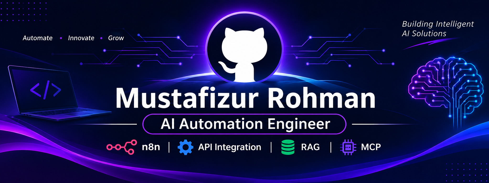

  

  
  
  

### AI Automation & n8n Workflow Engineer

---

## About Me

I am an **AI Automation Engineer** who builds workflow automations connecting APIs, AI agents, and business tools, so teams spend less time on repetitive work.

* **Currently building:** Voice AI agents, RAG-based assistants, and lead generation workflows
* **Core skills:** n8n, REST APIs, Webhooks, JSON, Supabase, AI Agents
* **Goal:** Help businesses reduce manual work through reliable, practical automation

---

## Skills & Experience

**Automation & Integrations:** n8n · make.com · APIs & Webhooks · MCP & Advanced Agents · Go High Level (GHL)

**AI Agents & Voice:** Voice & Data Agents · Retell AI (Voice Agent) · Claude MCP & Claude Code · Claude Skills & Connectors · Claude for Automation & Client Work

**Data & Knowledge:** RAG & Vector Databases · Data Fundamentals & Transformation · Web Scraping & Lead Generation

**Projects Explored:** Stock Analysis Agent (data-driven) · YouTube Automation

---

## Tech Stack & Tools

  
  &nbsp;&nbsp;
  
  &nbsp;&nbsp;
  
  &nbsp;&nbsp;
  
  &nbsp;&nbsp;
  
  &nbsp;&nbsp;
  

  
  
  
  
  
  
  
  

---

## Featured Projects

### Company Discovery & Data Enrichment (n8n)

A Telegram-driven workflow that turns a plain-language request (for example "Find 5 accounting firms in Australia") into a deduplicated company list in Google Sheets. It finds companies with Serper, scrapes their websites with Apify, classifies industries with AI, flags uncertain records for manual review, and sends Telegram summaries and failure alerts.

**Technologies:** n8n · Telegram · Serper · Apify · OpenAI · Claude · Google Sheets

**Links:** [GitHub repository](https://github.com/md-mustafizur/company-discovery-n8n) · [Video demo on LinkedIn](https://lnkd.in/p/g34cH8p3)

### n8n Gmail AI Email Triage

An AI workflow that classifies incoming emails into seven categories, applies Gmail labels, saves suggested replies as drafts (it never sends emails), and sends a Telegram alert for urgent messages.

**Technologies:** n8n · Gmail · Google Gemini · Telegram

**Links:** [GitHub repository](https://github.com/md-mustafizur/n8n-gmail-ai-email-triage) · [Video demo on LinkedIn](https://lnkd.in/p/gwy7K7bZ)

### RAG Customer Support AI Agent

An AI-powered customer support workflow that retrieves relevant information from a knowledge base and generates context-aware responses.

**Technologies:** n8n · Supabase Vector Store · AI Models · Gmail

**Key Features**

* Automated workflow execution using n8n
* Semantic document search using vector embeddings
* AI-generated responses based on retrieved context
* Email integration for customer support workflows

**Project Repository:** [View my GitHub repositories](https://github.com/md-mustafizur)

---

## Let's Connect

I'm interested in AI automation projects, workflow optimization, and opportunities to collaborate with businesses.

* **LinkedIn:** [Connect with me](https://linkedin.com/in/md-mustafizur-rohman-19b9163b5/)
* **GitHub:** [View my repositories](https://github.com/md-mustafizur)
* **Email:** [mustafizurrohman834@gmail.com](mailto:mustafizurrohman834@gmail.com)
<!-- Upwork / Fiverr: add link here once you have the profile URL -->
